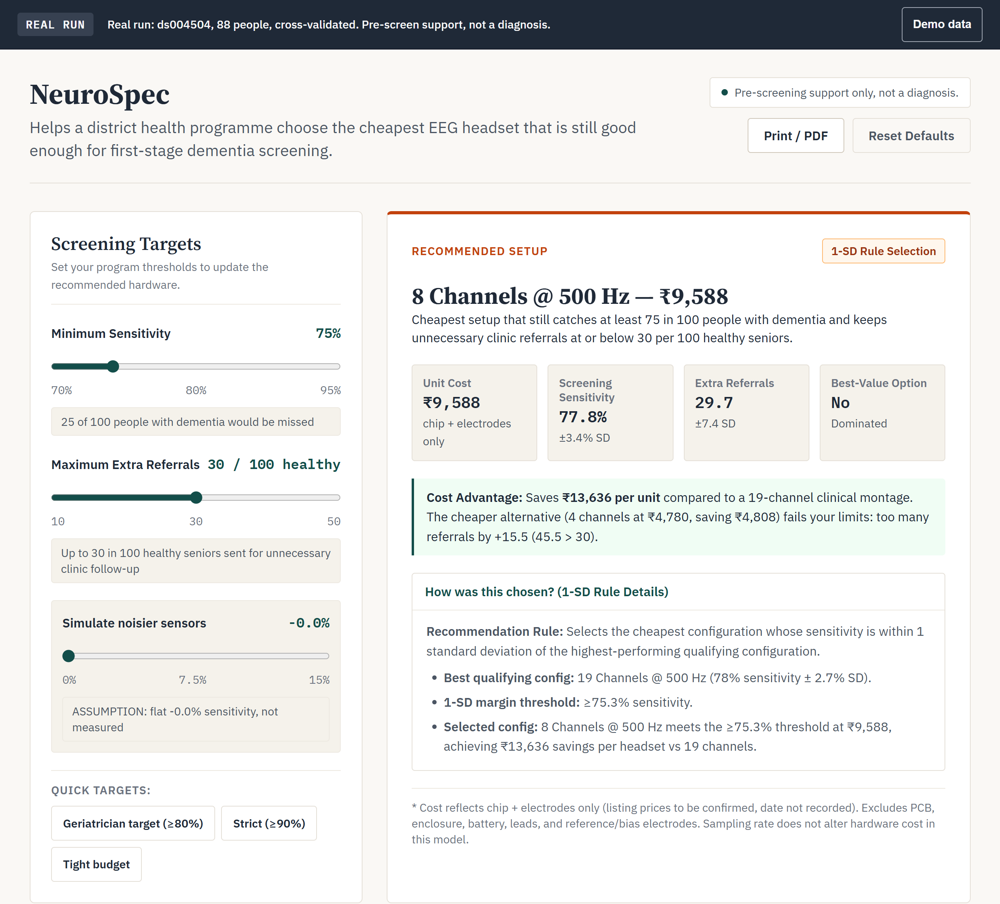
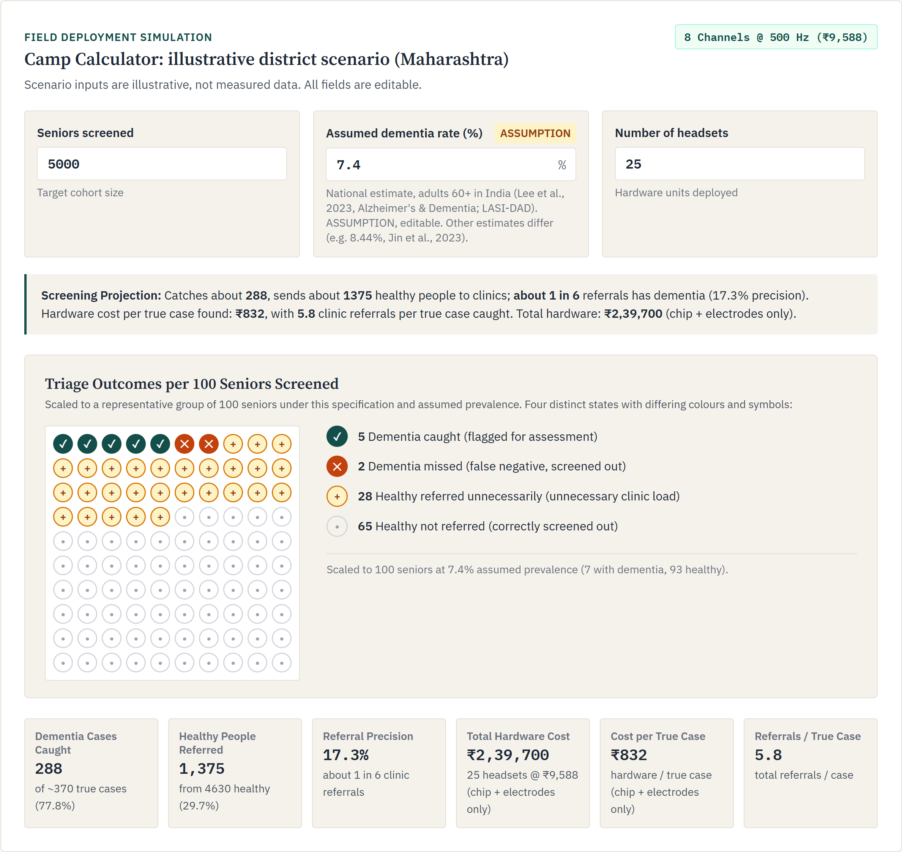
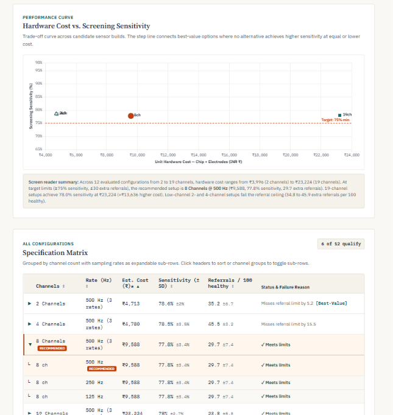
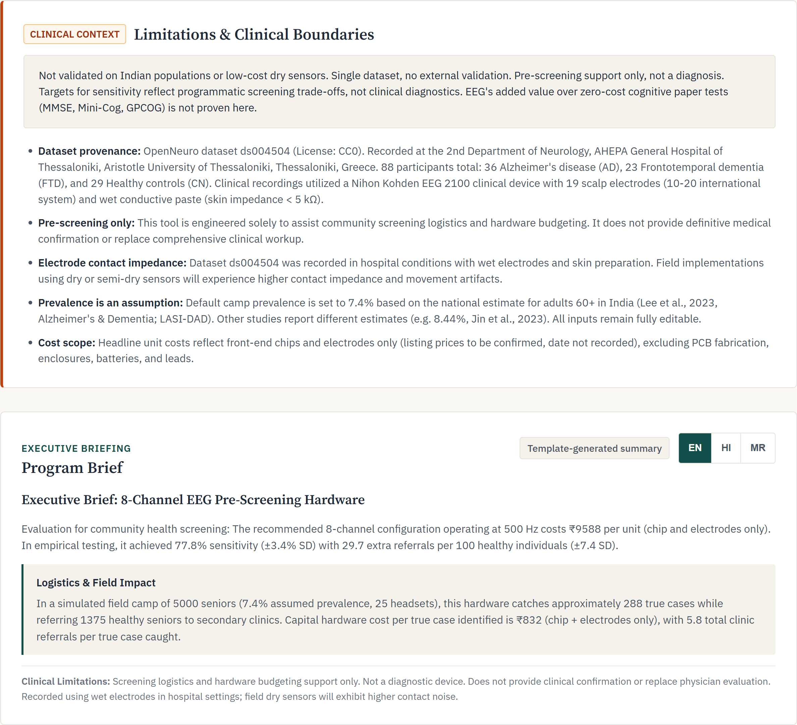
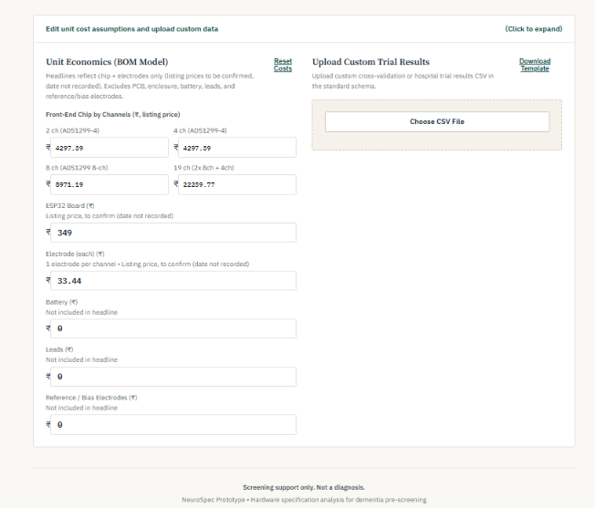

# NeuroSpec

NeuroSpec is a browser-based planning tool that helps community health programmes compare EEG headset specifications (channel count and sampling rate) by unit hardware cost, screening sensitivity, and unnecessary clinic referrals for first-stage dementia pre-screening. In the underlying classification task, the positive class is dementia (Alzheimer's disease plus frontotemporal dementia) versus healthy controls.

**Live Demo:** [https://neurospec.vercel.app](https://neurospec.vercel.app)

It is built for public health programme managers and procurement teams, using an illustrative district screening camp in Maharashtra as an example scenario.

> **Pre-screening planning tool only, not a diagnostic tool.** NeuroSpec does not diagnose dementia, is not clinically validated, and does not replace a clinician's examination.



---

## What it is

When planning community dementia screening camps, programmes face a trade-off:
- Too few EEG channels can miss cases or send too many healthy older adults for unnecessary clinic follow-up.
- Full 19-channel clinical EEG setups cost more per headset.

In the underlying evaluation, the classifier distinguishes a positive class of dementia (Alzheimer's disease plus frontotemporal dementia) from healthy controls. NeuroSpec lets a user:
- **Set screening limits:** choose minimum sensitivity (`70%`–`95%`, default `75%`) and maximum extra referrals per 100 healthy adults (`10`–`50`, default `30`).
- **Test a noisier-sensor assumption:** apply a flat sensitivity penalty (`0%`–`15%` in `0.5%` steps, default `0%`) to see how sensitive the choice is to lower signal quality.
- **See the 1-SD recommendation:** selects the cheapest qualifying configuration whose sensitivity is within 1 standard deviation (SD across 10 cross-validation repeats) of the best-performing qualifying configuration.
- **Explore a camp scenario:** estimate cases caught, healthy people referred, referral precision, total hardware cost, hardware cost per true case found, and referrals per true case for an editable cohort (defaults: `5,000` seniors, `25` headsets, `7.4%` assumed prevalence).
- **Inspect all configurations:** compare configurations on a cost-vs-sensitivity chart and a sortable specification table.
- **Edit unit costs & upload CSV results:** adjust chip/electrode/board costs or load your own trial CSV (`channels, sampling_rate_hz, sensitivity_pct, extra_referrals_per_100_healthy`).
- **View a static Program Brief (EN / HI / MR)** for the default 8-channel scenario and export a clean **Print / PDF** summary.

By default, the dashboard opens on **REAL RUN** results computed from OpenNeuro dataset `ds004504`. Illustrative placeholder **DEMO DATA** is available only behind an explicit toggle (`Load demo data`), which turns on a red warning banner.

---

## Screenshots

**Plan a screening camp (illustrative scenario)**


**Compare every setup**


**Limitations and Program Brief**


**Editable costs and CSV upload**


---

## How it works (pipeline)

The offline analysis in [`research/eeg_analysis.py`](research/eeg_analysis.py) runs the following pipeline:

1. **Input & Labels:** Reads `participants.tsv` and 19-channel EEGLAB `.set` recordings (`500` Hz) from OpenNeuro `ds004504`. Positive class (`1`): dementia — Alzheimer's disease (`A`) plus Frontotemporal dementia (`F`). Negative class (`0`): Healthy controls (`C`).
2. **Preprocessing:** Picks EEG channels, applies a `1.0`–`45.0` Hz band-pass filter (`mne`), and resamples (`raw.resample`) to `500`, `250`, and `125` Hz. Signals are split into non-overlapping `10`-second windows. (No artifact rejection or ICA is applied.)
3. **Features:** Computes Welch power spectral density (`scipy.signal.welch`, `nperseg` up to `4` seconds) across 5 bands—delta (`1–4` Hz), theta (`4–8` Hz), alpha (`8–13` Hz), beta (`13–30` Hz), and gamma (`30–45` Hz)—extracting `log10` absolute power and relative power (`1–45` Hz total). Window features are aggregated per participant using the **median**.
4. **Channel Subsets:** Evaluates 4 predefined subsets (`19`, `8`, `4`, and `2` channels: `Fp1, Fp2` for 2 ch; `+ C3, C4` for 4 ch; `+ F3, F4, P3, P4` for 8 ch; full 10–20 for 19 ch) at `500`, `250`, and `125` Hz, plus 20 random 2-channel pairs at `500` Hz.
5. **Model & Subject-Level Cross-Validation:** `StandardScaler` + `LogisticRegression(max_iter=3000, class_weight="balanced", random_state=42)` evaluated with **10 repeats of 5-fold stratified cross-validation at the participant level** (one row per participant per rate, so no participant appears in both train and test folds). Within each outer training fold, a 5-fold inner CV tunes the probability threshold to target `>= 80%` sensitivity on training data before evaluating on the outer test fold.
6. **Outputs & Dashboard:** Writes [`research/results/dashboard_results.csv`](research/results/dashboard_results.csv) and [`research/results/random_pairs.csv`](research/results/random_pairs.csv) (and `channel_comparison_repeated.csv` to the configured output directory). The dashboard stores the 12 configurations (mean and SD across 10 cross-validation repeats) in [`data.js`](data.js) (`REAL_RESULTS`) and computes hardware costs (`chip + ESP32 + electrodes`), Pareto frontier, 1-SD recommendation, and camp projections in [`app.js`](app.js).

More detail: [`research/README.md`](research/README.md) and [`docs/ARCHITECTURE.md`](docs/ARCHITECTURE.md).

---

## Results shown by the tool and what they do not prove

From [`research/results/dashboard_results.csv`](research/results/dashboard_results.csv) and [`data.js`](data.js) (`ds004504`, `88` participants: `59` AD+FTD, `29` controls; 10-repeat 5-fold participant-level CV, `500` Hz, threshold calibrated on training folds for `>= 80%` sensitivity):

| Channels | Unit cost (INR, chip + ESP32 + electrodes) | Sensitivity (% ± SD across 10 cross-validation repeats) | Extra referrals per 100 healthy (± SD across 10 cross-validation repeats) |
|---|---|---|---|
| 2 (`Fp1, Fp2`) | 4,713 | 78.6 ± 2.0 | 35.2 ± 6.7 |
| 4 (`Fp1, Fp2, C3, C4`) | 4,780 | 78.5 ± 3.5 | 45.5 ± 3.2 |
| 8 (`Fp1, Fp2, F3, F4, C3, C4, P3, P4`) | 9,588 | 77.8 ± 3.4 | 29.7 ± 7.4 |
| 19 (full 10–20) | 23,224 | 78.0 ± 2.7 | 23.8 ± 5.3 |

*(Results at `250` Hz and `125` Hz are in [`research/results/dashboard_results.csv`](research/results/dashboard_results.csv) and are within `0.0–1.0` points of the `500` Hz values; sampling rate does not change cost in the model.)*

At the 80% training calibration, test sensitivity is about 78%, below the 80 to 90% range a geriatrician suggested, and no tested setup reaches it.

Under the default limits (`>= 75%` sensitivity, `<= 30` extra referrals per 100 healthy, `0%` noise penalty):
- The 1-SD rule selects **8 channels at 500 Hz** (`₹9,588` unit cost; meets the `30` referral limit by `0.3` and sits within 1 SD across 10 cross-validation repeats of 19 channels at `78.0% ± 2.7`).
- The 2- and 4-channel setups exceed the `30` extra-referral limit (`35.2` and `45.5`).
- In the default camp scenario (`5,000` seniors, `25` headsets, `7.4%` assumed prevalence), 8 channels at `500` Hz catches about `288` of `~370` expected cases and refers `1,375` healthy people (`17.3%` referral precision), with hardware cost `₹2,39,700` (`₹832` per true case found, `5.8` referrals per true case).

**What these results do NOT prove:**
- They do not establish clinical sensitivity or specificity in real-world screening camps.
- They do not establish that 8-channel or dry-electrode hardware performs as well as hospital EEG.
- Because `channel_comparison_repeated.csv` is written outside the repo by `eeg_analysis.py` (`NEUROSPEC_EEG_OUTPUT`), the SD values (SD across 10 cross-validation repeats) in `data.js` cannot be verified solely from `research/results/dashboard_results.csv` without re-running the pipeline on `ds004504`.
- The Program Brief panel in the dashboard displays static template text from [`ai/briefs.json`](ai/briefs.json) for the default 8-channel scenario and does not update dynamically when sliders or camp inputs change.

---

## Limitations

- **Single dataset, hospital data in Greece:** All metrics come from one 88-participant hospital dataset (`ds004504`) recorded in Greece. Results are **not** externally validated and **not** validated in India or on Indian populations.
- **Wet electrodes vs low-cost dry sensors:** `ds004504` was recorded using clinical wet electrodes with conductive paste (`< 5 kΩ` skin impedance, resting state). Low-cost dry or semi-dry sensors in community camps will have higher contact impedance and more movement artifacts. Published dry-vs-wet comparisons mostly test healthy volunteers on research headsets (none test dementia detection), and several report dry electrodes diverging most in the delta and theta bands—which NeuroSpec's 1–45 Hz features rely on.
- **Sensor penalty is an assumption, not a measurement:** The dashboard's `"Simulate noisier sensors"` slider (`0%`–`15%`, default `0%`) subtracts a flat percentage-point penalty chosen by the user. It is an illustrative assumption, not measured dry-sensor data. (A separate computational Gaussian-noise script exists in [`research/noise_experiment.py`](research/noise_experiment.py) and is not wired into the dashboard.)
- **Added value over paper tests not proven:** Paper-and-pencil cognitive tests (MMSE, Mini-Cog, GPCOG) have near-zero hardware cost. Any added value of EEG over those tests is not shown here.
- **Prevalence and camp inputs are assumptions:** The default `7.4%` dementia prevalence is an editable assumption based on Lee et al., 2023 (*Alzheimer's & Dementia*, LASI-DAD national estimate for adults 60+ in India); other estimates differ (e.g., `8.44%`, Jin et al., 2023). The camp size (`5,000` seniors) and headset count (`25`) are illustrative.
- **Cost excludes board, case, battery and leads:** Headline costs (`₹4,713`–`₹23,224`, chip + ESP32 + electrodes) cover front-end ADS1299 chip(s), an ESP32 board (`₹349`), and `1` electrode per channel (`₹33.44` each) from unverified listing prices (check date not recorded). They exclude PCB fabrication, enclosure/case, battery, leads, reference/bias electrodes, and operating costs.

---

## How to run

### 1. Web dashboard
No build step or Node.js required (internet access is needed for Chart.js CDN and fonts):

```bash
python -m http.server 8080
```

Open `http://localhost:8080/index.html` in a browser. (Use a local HTTP server rather than `file://` so `fetch('ai/briefs.json')` loads cleanly without falling back to the embedded copy.)

### 2. Python environment & smoke tests
```bash
git clone https://github.com/0504Siddhi/Neurospec.git
cd Neurospec
python -m venv venv
# Windows: .\venv\Scripts\activate
# Linux/macOS: source venv/bin/activate
pip install -r requirements.txt
pytest tests/ -v
```

`pytest` runs synthetic EEG pipeline smoke tests, CSV schema checks, and brief number-validation checks without needing `ds004504`.

### 3. Re-running the EEG analysis (requires dataset download)
```bash
pip install openneuro-py
openneuro-py download --dataset ds004504 --target-dir ds004504-data
# Windows PowerShell: $env:NEUROSPEC_EEG_ROOT="$PWD\ds004504-data"
# Linux/macOS:        export NEUROSPEC_EEG_ROOT="$PWD/ds004504-data"
python research/eeg_analysis.py
```

### 4. Regenerating Program Briefs
```bash
python ai/generate_brief.py
```
Runs in deterministic template mode by default and writes [`ai/briefs.json`](ai/briefs.json). Optional LLM mode reads `BRIEF_API_KEY` from an environment variable and rejects outputs containing numbers not in the supplied metrics. Hindi and Marathi text should be reviewed by a fluent reader before use.

---

## Data source and license

- **Dataset:** OpenNeuro `ds004504`, CC0 license.
- **DOI:** 10.18112/openneuro.ds004504.v1.0.7
- **Recording hospital / site:** 2nd Department of Neurology, AHEPA General University Hospital of Thessaloniki, Aristotle University of Thessaloniki, Greece
- **Software license:** MIT License — see [`LICENSE`](LICENSE).

---

## Authors

- Team NeuroWell, PVG's COET&M, Pune.
